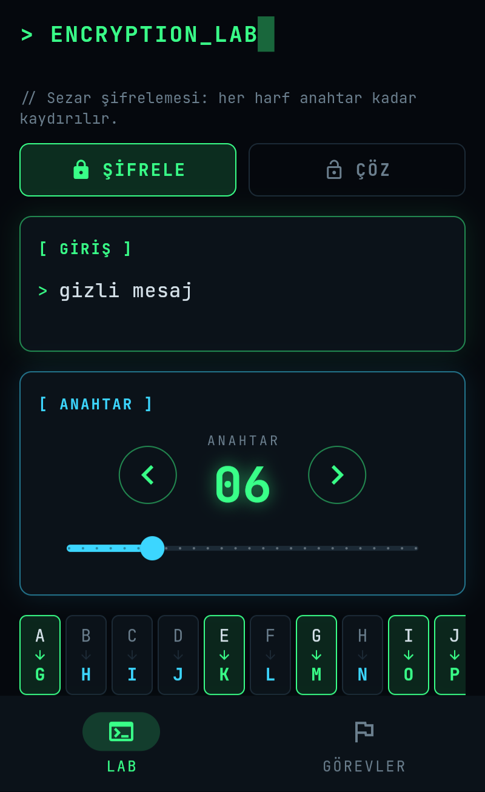
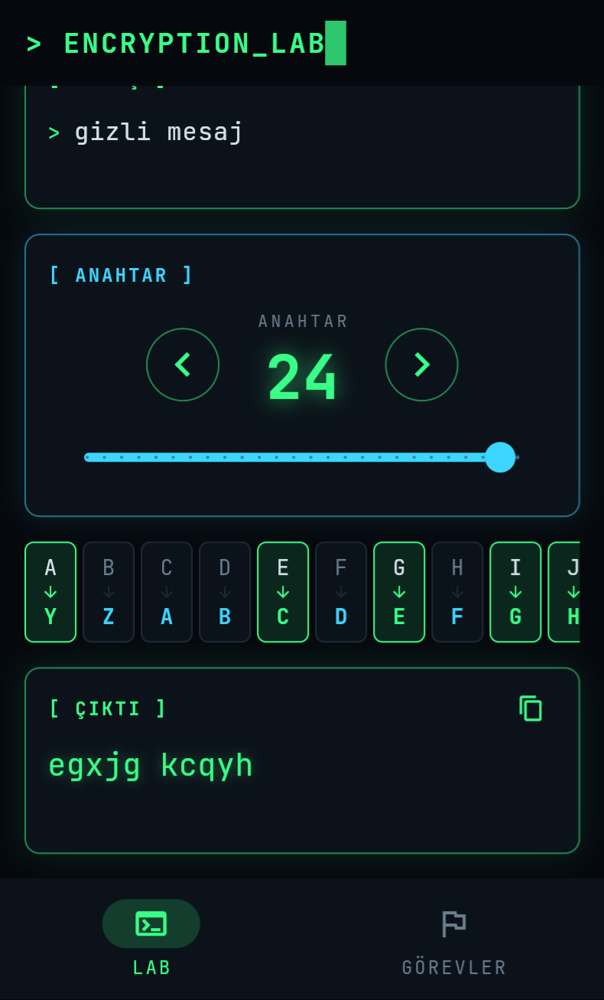
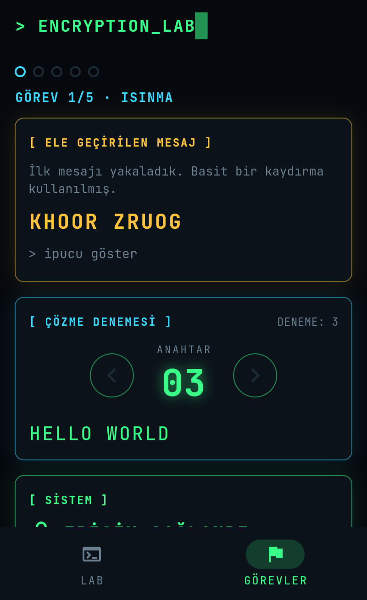
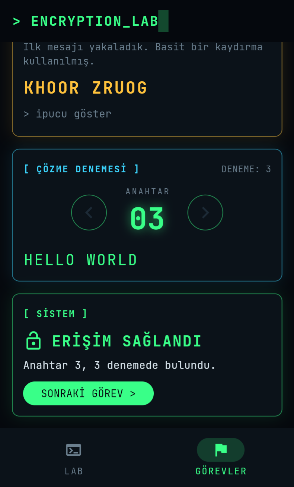

# Encryption Lab 🔐

Şifreleme algoritmalarını basitçe anlatan ve denemeyi sağlayan bir uygulama.
Sürüm sürüm geliştiriliyor; hedef, Flutter ile Android (Google Play) uygulaması.

- **LAB:** Mesajını yaz, anahtarı seç, şifreli hâlini anında gör.
- **GÖREVLER:** Ele geçirilen şifreli mesajların anahtarını bul, sistemi kır.

| LAB | | GÖREVLER | |
|:---:|:---:|:---:|:---:|
|  |  |  |  |
| Mesajını yaz, anahtarı seç | Şifreli çıktı | Ele geçirilen mesaj | Erişim sağlandı |

## Durum

| Sürüm | İçerik | Durum |
|-------|--------|-------|
| v0.1 | Sezar şifrelemesi (terminal) | ✅ Tamamlandı |
| v0.2 | Flutter arayüzü, Android APK | ✅ Tamamlandı |
| v0.3 | Hacker teması, GÖREVLER oyunu | ✅ Tamamlandı |
| v0.4 | Türkçe alfabe desteği | Planlandı |
| v1.0 | Google Play yayını | Planlandı |
| sonra | Vigenère ve diğer algoritmalar | Planlandı |

## Sezar şifrelemesi nasıl çalışır?

Her harf alfabede sabit bir sayı (anahtar) kadar kaydırılır.

```
Anahtar 3:  A B C ... X Y Z
            ↓ ↓ ↓     ↓ ↓ ↓
            D E F ... A B C

MERHABA  →  PHUKDED
```

- Şifreleme: `yeni = (eski + anahtar) mod 26`
- Çözme: `eski = (yeni − anahtar) mod 26`

Harf olmayan karakterler (boşluk, rakam, noktalama) değişmez.

## Proje yapısı

```
bin/
  encryption_lab.dart        # Terminal menüsü
lib/
  main.dart                  # Flutter uygulamasının giriş noktası
  src/missions.dart          # Görev listesi
  src/ui/theme.dart          # Renkler ve tema
  src/ui/widgets.dart        # Ortak parçalar (panel, kadran, animasyon)
  src/ui/home_shell.dart     # Başlık ve alt sekmeler
  src/ui/caesar_screen.dart  # LAB ekranı
  src/ui/missions_screen.dart # GÖREVLER ekranı
  encryption_lab.dart        # Kütüphanenin dışa açılan kısmı
  src/ciphers/caesar.dart    # Sezar algoritması (arayüzden bağımsız)
  src/input.dart             # Giriş kontrolü
test/
  caesar_test.dart           # Algoritma testleri
  input_test.dart            # Giriş kontrolü testleri
  missions_test.dart         # Görev testleri
  widget_test.dart           # Ekran testleri
assets/fonts/                # JetBrains Mono yazı tipi
```

Algoritmalar arayüzden bağımsız saf Dart kodudur. Böylece aynı kod hem
terminal sürümünde hem Flutter uygulamasında kullanılır.

## Uygulamayı telefona kurmak

APK dosyasını GitHub otomatik üretiyor:

1. Depodaki **Actions** sekmesine gir, en üstteki yeşil tikli çalışmaya tıkla.
2. Sayfanın altındaki **Artifacts** bölümünden `encryption-lab-apk` dosyasını indir.
3. Zip'in içindeki `app-release.apk` dosyasını telefona at ve aç.
   Android "bilinmeyen kaynak" uyarısı verirse izin ver.

## Bilgisayarda çalıştırma

[Flutter](https://docs.flutter.dev/get-started/install) kurulu olmalı.

```bash
flutter pub get                    # bağımlılıkları indir
flutter create . --platforms=android --project-name encryption_lab   # ilk seferde
flutter run                        # uygulamayı başlat
flutter test                       # testleri çalıştır
dart run                           # terminal sürümü
```

## Lisanslar

JetBrains Mono yazı tipi [SIL Open Font License 1.1](assets/fonts/OFL.txt) ile kullanılmaktadır.
